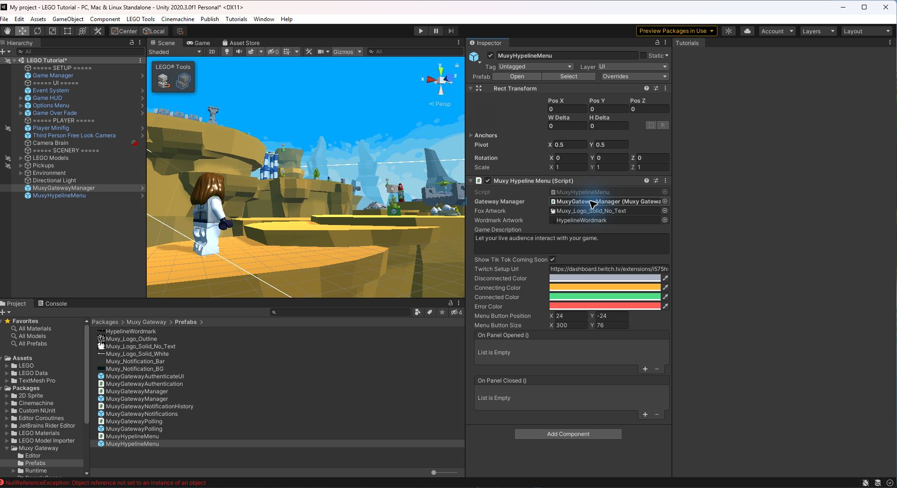
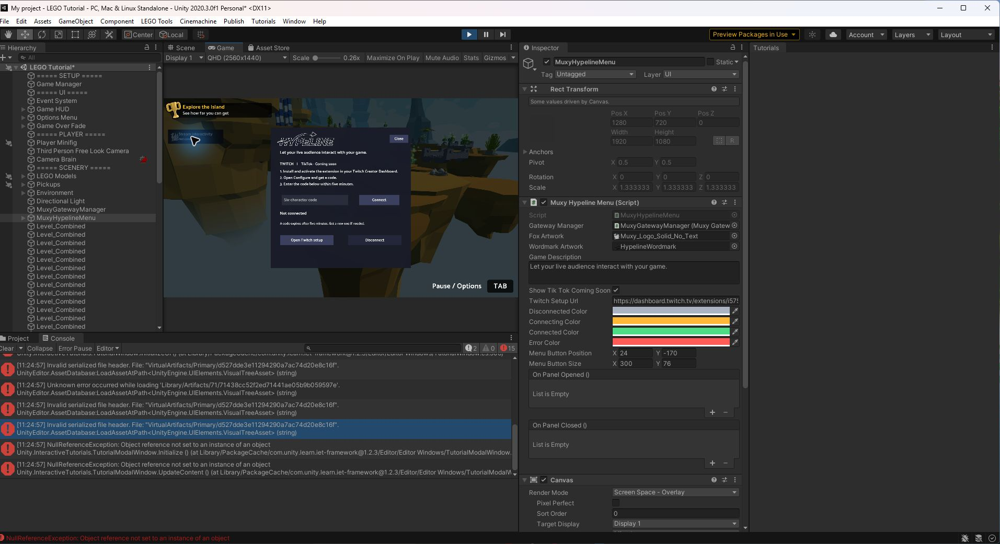
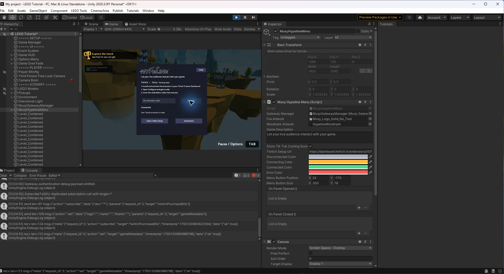
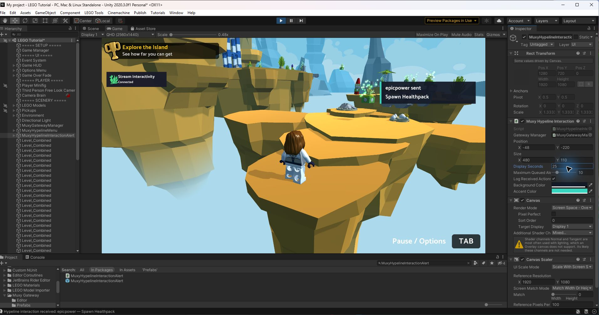
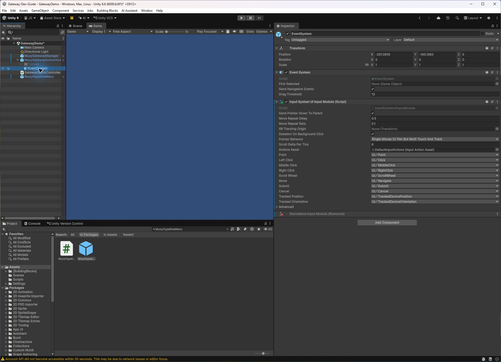
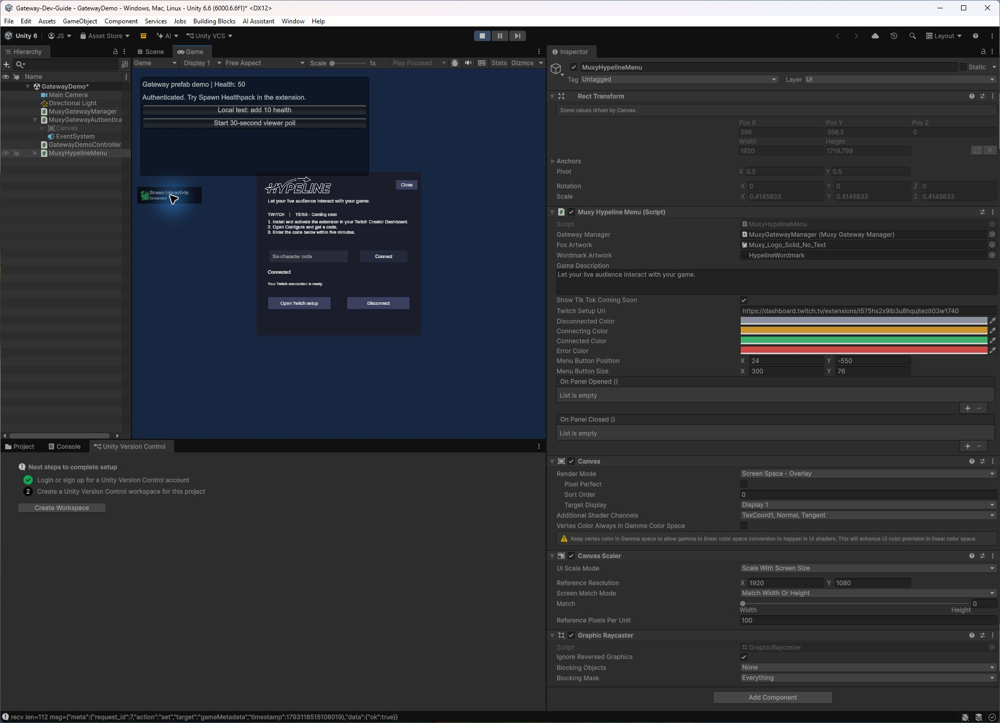
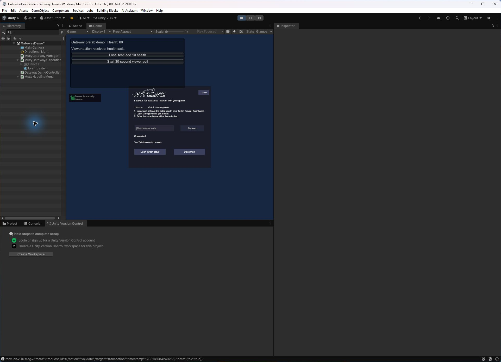
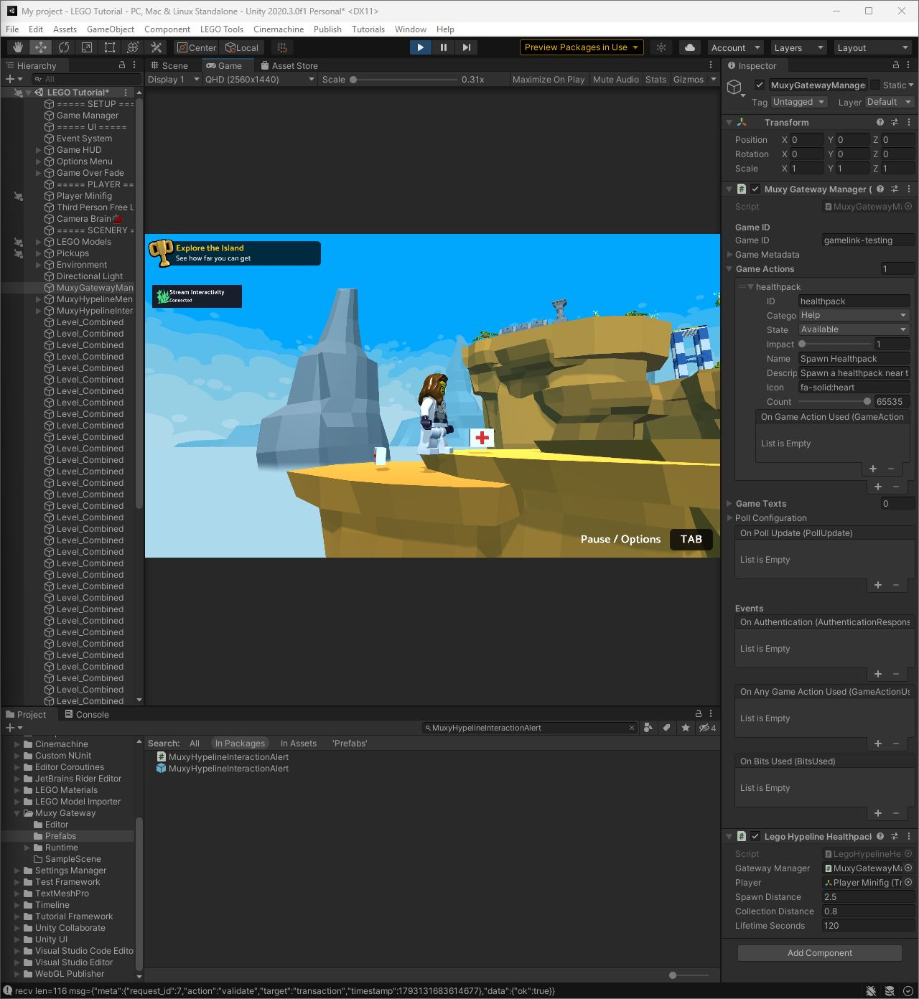
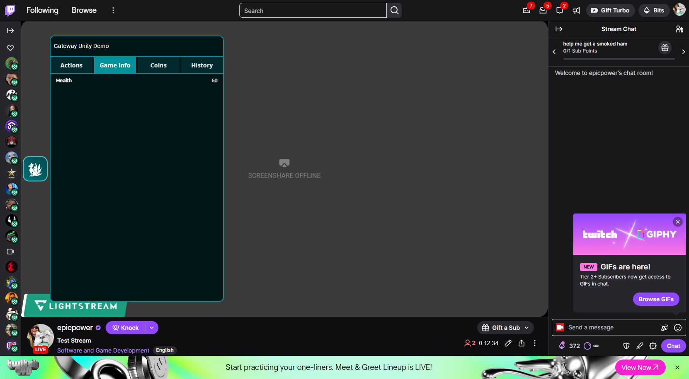
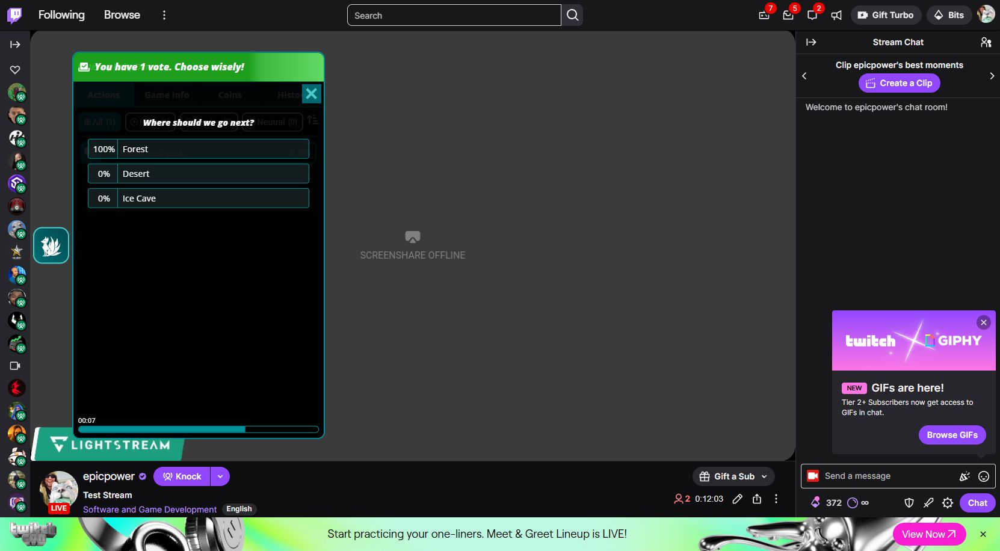

# Add the Muxy Hypeline creator menu in Unity

This guide adds a main-menu connection button, Twitch setup panel, and fox connection indicator to a PC game. TikTok is displayed as coming soon; it is not a working connection option yet. The Hypeline SDK uses the existing Muxy Gateway service and Twitch extension.

## 1. Install the SDK

1. In Unity, open **Window → Package Manager**.
2. Add the Muxy Unity package. To test the local development copy, use **Add package from disk** and select its `package.json`. For a distributed package, use the package URL or release supplied by Muxy.
3. Wait for package import and compilation. In the Project window, open **Packages → Muxy Hypeline → Prefabs**.
4. Import **TMP Essential Resources** if Unity prompts you. The scene must contain one EventSystem, configured for the project's active input system.

## 2. Add and wire the prefabs

1. Drag **MuxyGatewayManager** from the Prefabs folder into the Hierarchy. If the scene already has a manager, reuse it; only one should be active.
2. Select the manager and enter the game ID linked to the broadcaster in Twitch's extension configuration. Set game metadata and configure the actions your game supports.
3. Drag **MuxyHypelineMenu** into the Hierarchy. Select it, then drag the scene's manager into its **Gateway Manager** field.
4. Enter a **Game Description** that tells creators what viewers can do in your game. The TikTok coming-soon label and the artwork and colors are configurable in the Inspector.
5. Set **Menu Button Position** to fit your menu. In the tested LEGO scene the default overlapped the existing top-left HUD; changing Y from `-24` to `-170` made the button visible. This value is an example, not a universal setting.
6. The UI is created when the game runs, so the button and panel do not appear as editable children in the prefab before Play mode. The root may be placed under an existing Canvas; if it has no Canvas parent, the component creates an overlay Canvas at runtime.

## 3. Connect Twitch

1. On the broadcaster's Twitch Creator Dashboard, install and activate the existing Muxy Gateway extension in a supported slot.
2. Open the extension's **Configure** view. Verify the game ID under **Linked Games**, and get the six-character code.
3. Enter Play mode, select **Stream Interactivity**, enter the code, and select **Connect**. Codes expire after five minutes; use **Get New Code** in the extension configuration if necessary.
4. The fox and label display **Connected** after the transport is open and authentication succeeds. The panel can disconnect the creator or open the Twitch setup page.
5. Use a separate viewer session to activate a configured action in the Twitch extension and observe the result in the game. A successful connection alone does not verify an action callback.

Gray means not connected; amber means connecting or reconnecting; green means connected; red means a connection or authentication issue. These colors are paired with text labels. A newly added menu does not automatically create game actions: configure actions and their handlers on the manager or in game code.

## Viewer interaction alerts

1. Add **MuxyHypelineInteractionAlert** from the package's Prefabs folder to the scene and assign the same **Gateway Manager** used by the creator menu. The alert subscribes automatically to the manager's `OnAnyGameActionUsed` event.
2. Register the actions your game supports on the manager, with an ID matching the action selected by viewers. For the test action use ID `healthpack`, name `Spawn Healthpack`, category **Help**, state **Available**, impact `1`, and count `65535`.
3. Run the game and connect it to Twitch. A received action displays the viewer and action near the upper right and, by default, logs `Hypeline interaction received` in the Unity Console. Adjust **Position**, **Size**, colors, and sound volume in the Inspector. If the backend supplies no viewer name, the alert uses “A viewer”; if the action has no registered display name, it uses the action ID.
4. Implement and bind a separate gameplay handler. The alert confirms an action callback was received; it does not spawn a healthpack or accept/refund a transaction. Only advertise actions that your game can fulfill, and handle transaction outcomes in that game-specific code. Use `ShowAlert(viewerName, actionName)` to preview the UI without sending an action; a preview is not a live test.

The UI is built in Play mode. Each incoming alert appears immediately for six seconds and fades during its last second. New alerts appear at full size at the top; older alerts move down and scale to 60% of the preceding alert's size. Help, Hinder, and Neutral each use a different generated sound. Assign optional custom audio clips in the Inspector to replace them, or turn off **Play Sounds**. Sound playback requires an active Unity Audio Listener and unmuted game audio. Place the prefab under a screen-space Canvas or let it create an overlay Canvas. The default offset assumes a 1920 × 1080 reference resolution.

In the LEGO test scene, **Test Neutral Alert** and **Test Hinder Alert** are zero-cost, alert-only interactions; they have no gameplay effect. Both were sent through Twitch and acknowledged by Unity. The user confirmed hearing both sounds. Scene changes are unsaved until saved in Unity.

## Unity 6

The package uses Unity's resolved uGUI/TextMeshPro packages. Do not manually downgrade uGUI or copy an old TextMeshPro package into the project. The component contains a Unity 6-specific TextMeshPro wrapping setting; older SDK copies with `enableWordWrapping` can fail to compile in Unity 6. Use the updated package.

In the tested Unity 6.6 demo, the manager and demo controller were already in the scene:

1. Add **MuxyHypelineMenu** and assign the existing manager.
2. The existing authentication prefab contains an EventSystem as a sibling of its Canvas. Disable the old authentication **Canvas** if replacing its UI, while keeping that EventSystem enabled.
3. Select the EventSystem and use **Input System UI Input Module** for a new-Input-System-only project. The tested scene already had this module configured. Do not add a second EventSystem.
4. Move the Hypeline button away from the demo's top-left controls; the test used Y `-550`. Adjust this to your own layout.
5. Run the scene. The existing saved session reauthenticated automatically, the fox turned green, and the panel reported **Connected**.

## Verification and limitations

- Unity 2020.3.0f1: local package imported; manager and menu were assigned; the menu opened in Play mode and connected using a fresh Twitch configuration code. The LEGO scene's existing HUD required a position adjustment. After registering `healthpack` and assigning the alert, a zero-cost Twitch action displayed the viewer and action and logged receipt. A LEGO-specific sample handler then spawned a visible healthpack beside the minifigure during a live Twitch action; the transaction was acknowledged. The LEGO tutorial has no health system, so this sample pickup does not heal. The handler is in the LEGO test project's Assets, and the scene setup must be saved there.
- The public [Unity Gateway tutorial](https://docs.muxy.io/docs/unity-gateway-tutorial) contains older sample API names and syntax. Use the package's current API and the [maintained prefab quickstart](https://muxy.github.io/github-pages/docs/unity-gateway-prefab-quickstart/) when following along.
- Unity 6000.6.6f1: authenticated automatically with an existing saved session. The free **Spawn Healthpack** Twitch action changed demo health from 50 to 60, and the extension's Game Info showed Health 60. A viewer voted Forest in a 30-second poll, and the game reported Forest as the winner.
- The interaction alert script also compiled in Unity 6000.6.6f1 with no compiler errors; its live interaction test was performed in Unity 2020.
- The Twitch configuration modal initially appeared blank and eventually loaded after a delay. Its precise cause was not determined. Do not record codes or tokens in screenshots, source control, or logs.
- The tested Unity 2020 LEGO scene also produced unrelated LEGO tutorial and `AliveAction` errors; the Hypeline panel still opened. Test a clean project if diagnosing those scene-specific errors.
- The existing manager stores refresh tokens in `PlayerPrefs`; that storage is not encrypted. This component does not add WebGL support.

