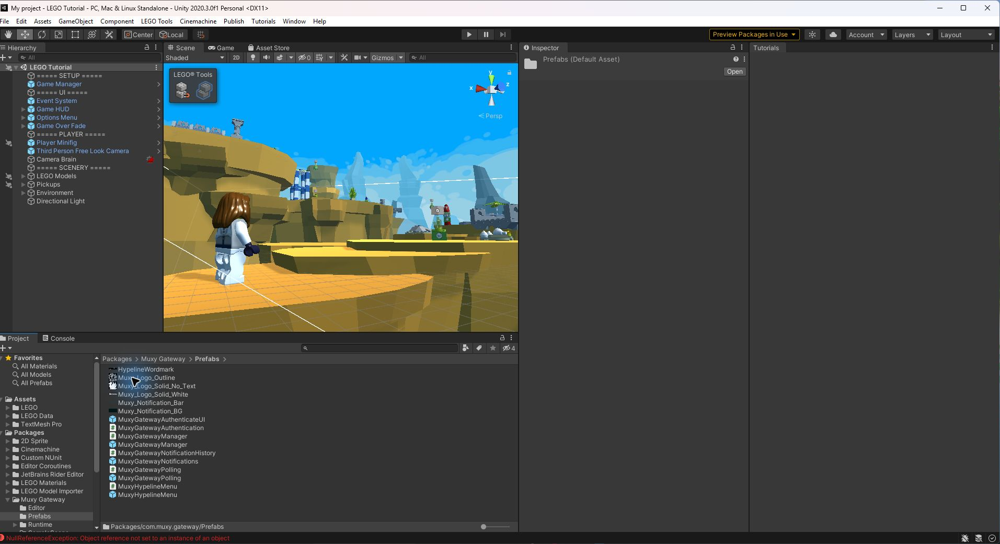

# Add the Muxy Hypeline creator menu in Unity

This guide adds a main-menu connection button, Twitch setup panel, and fox connection indicator to a PC game. TikTok is displayed as coming soon; it is not a working connection option yet. The Hypeline SDK uses the existing Muxy Gateway service and Twitch extension.

## 1. Install the SDK

1. In Unity, open **Window → Package Manager**.
2. Choose **Add package from git URL** and enter `https://github.com/jrslyce/gateway-unity.git#codex/hypeline-developer-readiness`. This is a development branch; record the resolved commit for your test. Alternatively, choose **Add package from disk** and select a local SDK checkout's `package.json`.
3. Wait for package import and compilation. In the Project window, open **Packages → Muxy Hypeline → Prefabs**.
4. The scene must contain one EventSystem, configured for the project's active input system. The included Hypeline prefabs use Unity UI and do not require TextMesh Pro.

## 2. Add and wire the prefabs

1. Drag **MuxyGatewayManager** from the Prefabs folder into the Hierarchy. If the scene already has a manager, reuse it; only one should be active.
2. Select the manager. Its Game ID defaults to `gamelink-testing`; configure game metadata and the actions your game supports. Existing managers with an empty Game ID use the same testing ID at runtime.
3. Drag **MuxyHypelineMenu** into the Hierarchy. Select it, then drag the scene's manager into its **Gateway Manager** field.
4. Enter a **Game Description** that tells creators what viewers can do in your game. The TikTok coming-soon label and the artwork and colors are configurable in the Inspector.
5. Set **Menu Button Position** to fit your menu. In the tested LEGO scene the default overlapped the existing top-left HUD; changing Y from `-24` to `-170` made the button visible. This value is an example, not a universal setting.
6. Expand the menu prefab in the Hierarchy to edit **Stream Interactivity** and **Hypeline Panel → Card**. Place the menu under a Canvas to see it in the Scene view, and use the Rect Tool to position or resize its children. Toggle the panel GameObject off in edit mode to work on the launcher; the script opens and closes the panel at runtime. Older hierarchies rebuild at runtime; replace the scene instance with the updated prefab to edit the new hierarchy, and review any custom child overrides.

## 3. Connect Twitch

1. On the broadcaster's Twitch Creator Dashboard, install and activate the existing Muxy Gateway extension in a supported slot.
2. Open the extension's **Configure** view. Verify the game ID under **Linked Games**, and get the six-character code.
3. Enter Play mode and select **Stream Interactivity**. Use **Open Twitch** to install and activate the extension, then **Open configuration** to return to the extension page and choose **Configure**. Enter the code and select **Connect**. Codes expire after five minutes; use **Get New Code** in the extension configuration if necessary.
4. The fox and label display **Connected** after the transport is open and authentication succeeds. The panel can disconnect the creator or open the Twitch setup page.
5. Use a separate viewer session to activate a configured action in the Twitch extension and observe the result in the game. A successful connection alone does not verify an action callback.

The redesigned panel shows **You are connected** after successful authentication. The menu fox stays green while connected.

Gray means not connected; amber means connecting or reconnecting; green means connected; red means a connection or authentication issue. These colors are paired with text labels. A newly added menu does not automatically create game actions: configure actions and their handlers on the manager or in game code.

## Viewer interaction alerts

1. Add **MuxyHypelineInteractionAlert** from the package's Prefabs folder to the scene and assign the same **Gateway Manager** used by the creator menu. The alert subscribes automatically to the manager's `OnAnyGameActionUsed` event.
2. Register the actions your game supports on the manager, with an ID matching the action selected by viewers. For the test action use ID `healthpack`, name `Spawn Healthpack`, category **Help**, state **Available**, impact `1`, and count `65535`.
3. Run the game and connect it to Twitch. A received action displays the viewer and action near the upper right and, by default, logs `Hypeline interaction received` in the Unity Console. Adjust **Position**, **Size**, colors, and sound volume in the Inspector. If the backend supplies no viewer name, the alert uses “A viewer”; if the action has no registered display name, it uses the action ID.
4. Implement and bind a separate gameplay handler. The alert confirms an action callback was received; it does not spawn a healthpack or accept/refund a transaction. Only advertise actions that your game can fulfill, and handle transaction outcomes in that game-specific code. Use `ShowAlert(viewerName, actionName)` to preview the UI without sending an action; a preview is not a live test.

The UI is built in Play mode. Each incoming alert appears immediately for six seconds and fades during its last second. New alerts appear at full size at the top; older alerts move down and scale to 60% of the preceding alert's size. Help, Hinder, and Neutral each use a different generated sound. Assign optional custom audio clips in the Inspector to replace them, or turn off **Play Sounds**. Sound playback requires an active Unity Audio Listener and unmuted game audio. Place the prefab under a screen-space Canvas or let it create an overlay Canvas. The default offset assumes a 1920 × 1080 reference resolution.

In the LEGO test scene, **Test Neutral Alert** and **Test Hinder Alert** are zero-cost, alert-only interactions; they have no gameplay effect. Both were sent through Twitch and acknowledged by Unity. The user confirmed hearing both sounds. Scene changes are unsaved until saved in Unity.

## Unity 6

The package uses Unity's resolved uGUI package for its built-in text and input components. TextMesh Pro and TMP Essential Resources are not required by these prefabs.

1. Add one **MuxyGatewayManager** and **MuxyHypelineMenu** to your scene, then assign the manager to the menu.
2. Keep one active EventSystem. For a new-Input-System-only project, use **Input System UI Input Module**.
3. Adjust the Hypeline button position to fit your menu. Enter Play mode, open **Stream Interactivity**, and follow the Twitch setup steps.
4. Confirm the panel reports **You are connected** and the menu fox turns green. Check the `Hypeline:` Console messages if a connection fails or stalls.

## Verification and limitations

- The redesigned menu and its open/close behavior were checked in Unity 6000.0.85f1. The package also imported and compiled in Unity 2022.3.62f3. Historical validation is recorded in [verification](VERIFICATION.md); it should not be treated as a live test of the current redesigned panel.
- Test a fresh connection and a real viewer action in your own project and target player. A connected indicator or visual alert does not prove the gameplay effect or transaction was fulfilled.
- The manager stores refresh tokens in `PlayerPrefs`, which is not encrypted. This package does not add WebGL support.
- If connection stalls, review the `Hypeline:` Console messages. After a timeout, restart Play mode and request a fresh code. Never share PINs or tokens.
